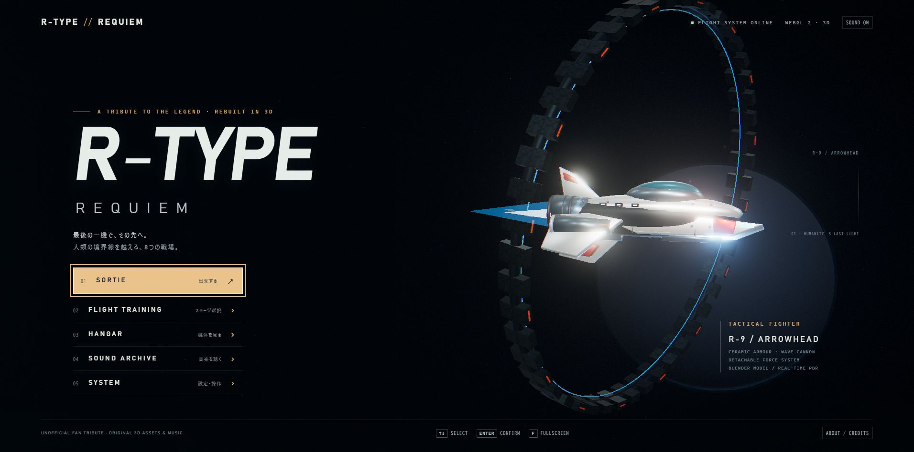
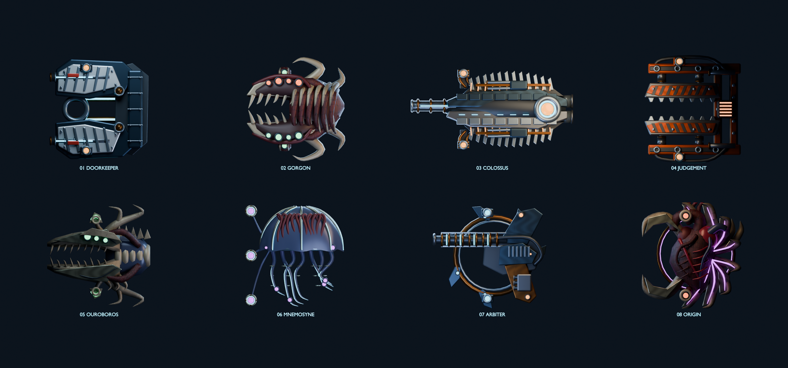

# R-TYPE // REQUIEM

**Blenderで制作した3D機体と生体兵器、着脱式フォース、波動砲、8つの独自戦場を備えるブラウザーSTGです。**

[ゲームを開く](https://yawakihara.github.io/R-TYPE/) · [ソースコード](https://github.com/yawakihara/R-TYPE)



R-TYPEのゲームデザインに敬意を表した非公式のファン作品です。原作の完全移植ではありません。原作の画像・音源・モデル・コード・ROMは取り込まず、モデルと楽曲を本作用に制作しています。

## 遊ぶ

タイトルの「SORTIE」から難易度を選んで発進します。「FLIGHT TRAINING」では全ステージを自由に選べます。「BOSS / ボス直行」に切り替えると、各面のボスと直接対戦でき、ミス後もボス戦から再開します。撃破後は次のボスへ進みます。初めての場合はCADETがおすすめです。

- 矢印 / WASD：移動
- C：押している間、連射
- Z / Space / J：押すと通常弾、長押しして離すと波動砲。約1.65秒で最大出力
- X / K：フォースの射出・回収
- Shift：速度を切り替える。Sアイテムで上限アップ
- Q：DRIVEが満タンなら時間減速を発動。クラシック設定では無効
- T：自動連射を切り替える。溜め撃ち中は連射を止める
- Esc / P：ポーズ、F：全画面、M：ミュート

ゲームパッドは左スティック・十字キー、A＝波動砲、B＝フォース、X＝連射、Y＝DRIVE、RB＝速度、START＝ポーズです。タッチ操作にも対応しています。

## 攻略の仕組み

一撃死と地形接触死、チェックポイント復帰を基本とします。ARCADEでは残機3、ミスで装備を失います。CADETは残機5、敵弾を遅くし、装備を保持します。ACEは弾速・攻撃密度が増え、撃ち返し弾があります。

白い補給機を壊してクリスタルを取得するとフォースが到着します。機首側から接触すれば前方、機尾側からなら後方へ合体します。通常弾を防ぎ、射出したフォースは敵に接触してダメージを与え、地形を通過できます。

赤＝螺旋状の対空レーザー、青＝上下の地形で反射するレーザー、黄＝床や天井を這う対地レーザー。3段階まで成長します。Bは防御用ビット、Mは追尾ミサイル、Sは速度強化です。

ボス8体はそれぞれ専用の機構とBlenderモデルを持ちます。発光する部位の下の小さなバーが部位耐久です。戦艦は冷却装置2基、神経中枢は神経節3個の破壊が核の開放条件です。その他のボスでも部位破壊が攻撃を減らしたり開放時間を延ばしたりします。画面上部に現在の機構と攻略ヒントを表示します。予告線は照準時に固定され、1.4〜1.6秒後に主砲・圧砕柱・格子が作動します。最終ボスの核は露出時のフォース接触だけが有効です。

50,000点、150,000点、以降150,000点ごとに残機が増えます。敵撃破とすれすれ回避でDRIVEを蓄積し、満タンなら約4.5秒の時間減速と高速チャージを使えます。

## 8つの戦場

1. **DERELICT GATE / DOORKEEPER**：連装砲と冷却シャッターを持つ装甲門。砲塔を両方壊すと排熱の隙が延びます。
2. **LIVING ABYSS / GORGON**：牙を開いて自機側へ急突進する捕食者。捕食後の口内が弱点。孵化嚢を壊すと幼体の増援を止められます。
3. **SILENT COLOSSUS / COLOSSUS CORE**：長い電磁主砲と冷却フィンを持つ巨大戦艦。照準後に砲身が固定され、主砲を放射。上下の冷却装置を壊すと発射後に炉心が開きます。
4. **IRON CATHEDRAL / JUDGEMENT**：油圧プレスと焼却柱を持つ要塞。予告された縦の帯を避け、圧盤が戻った時に核へ攻撃します。サーボを壊すと圧砕柱が減ります。
5. **OSSUARY / OUROBOROS**：骨環・大顎・骨棘を持つ骨竜。骨弾の扇を放ち、身を縮めて突進。身をほどいた隙が弱点です。
6. **NEURAL STORM / MNEMOSYNE**：神経の傘と7本の触手を持つ中枢。3個の神経節を壊すと弾幕が消え、シールドが停止。神経節はその後再生します。
7. **EVENT HORIZON / THE ARBITER**：回転する光翼と多重レーザー格子を持つ防衛機。予告線の間へ移り、翼が停止した時に核を狙います。制御器を両方壊すと格子が減ります。
8. **REQUIEM / ORIGIN**：動脈と開閉する外殻を持つ始原の心臓。心拍弾の後の拡張期にフォースを射出。核に届くと吸着し、拡張している間だけ損傷します。装備がなければ補給機が出現します。



[ボス改修の仕様と検証記録](BOSS_UPDATE.md)

## 表示・音響

Blender 5.2.2で制作した9種類の基本モデルと8体の専用ボスをglTF 2.0で読み込みます。金属とセラミックのPBR材質、環境反射、複数光源、ブルーム、装甲・骨・筋組織の表面テクスチャ、破片・スパーク、奥行きのある構造物をThree.jsで描画します。編集用の[基本モデル](../art/requiem-assets.blend)・[ボス一覧](../art/requiem-bosses.blend)と、[基本制作スクリプト](../tools/make_models.py)・[ボス制作スクリプト](../tools/make_bosses.py)を同梱しています。

全11曲をWeb Audioで合成します。MODERNとARCADE FMの音源切替、残響、ステレオディレイ、ドラム、専用効果音を実装しています。SOUND ARCHIVEのEXPORT / WAVから、選択曲の32秒ステレオWAVを保存できます。

波動砲は、溜めるほど低い唸り・金属の共鳴・旋回する電気ノイズがせり上がります。発射時は白い核、青い螺旋状のプラズマ、膨張する余波、残光に、放電音・重低音・飛翔音・ステレオの残響を重ねています。ポーズや画面移動では蓄積音を止めます。

敵への命中では火花と白い被弾反応が出ます。撃破時は敵の位置に閃光・爆炎・衝撃波が広がり、敵モデルが消えた後も煙と装甲片が残ります。補給機や砲台、生体兵器にも対応し、大型ボスは連鎖爆発します。

[蓄積から最大出力の発射までの試聴（5秒・WAV）](audio/REQUIEM-wave-cannon-modern.wav)

[ステージ1のBGM試聴ファイル（32秒・WAV）](audio/REQUIEM-01-modern.wav)

描画品質はULTRA / HIGH / BALANCED / PERFORMANCEから選べます。低フレームレートが続く場合は描画解像度・ブルームを自動で段階的に下げます。ブラウザーの非表示・ウィンドウの遮蔽等による制限は別途影響します。

## ローカルで起動

Node.js 22以降を使用します。

```powershell
npm ci
npm test
npm run build
node tools/serve.mjs --dist
```

`http://127.0.0.1:8137`を開きます。`file://`でHTMLを直接開く方法には対応していません。実行時CDNは不要で、静的サーバーと配布物だけで動作します。

モデルの再制作は、インストール済みBlenderで実行します。

```powershell
& 'C:\Program Files\Blender Foundation\Blender 5.2\blender.exe' --background --factory-startup --python tools/make_models.py
& 'C:\Program Files\Blender Foundation\Blender 5.2\blender.exe' --background --factory-startup --python tools/make_bosses.py
npm run build
```

## 検証

[検証記録](VALIDATION.md)に、実施内容と未確認の範囲を分けて記載しています。

波動砲の表示・音響を再確認する場合は、`node node_modules/esbuild/bin/esbuild tests/wave-lab.mjs --bundle --format=esm --outfile=.cache/wave-lab.js`で検証ページ用JSを作り、`node tools/serve.mjs`で起動して`/tests/wave-lab.html`を開きます。製品の描画・音声クラスを使い、3段階×2音源と蓄積音の停止を検証できます。

自動テストの通しプレイは描画なし・被弾無効の練習条件で、通常の射撃・チャージ・フォース操作を使います。人が残機制限内で全ステージをクリアしたという意味ではありません。

表示確認用URLパラメーターは`?stage=1&loadout=3&free=1&qa=1`。stageは1〜8、loadoutは0〜3、free=1で接触ミスなしの練習です。`encounter=boss`はボス戦から開始します。これらは常に練習として起動し、ランキングには記録しません。

## 公開

GitHub Actionsでテスト・ビルド後、distをGitHub Pagesへ公開します。ワークフローは`.github/workflows/pages.yml`です。通常の修正はmainへのpushで反映します。

## 権利・ライブラリ

「R-TYPE」および原作に関する権利は各権利者に帰属します。本作は権利者による公式作品ではなく、関係・提携・承認を示すものではありません。

Three.jsはMIT Licenseで利用しています。ライセンス本文は配布物の`third-party/three-LICENSE.txt`に同梱します。新規コード・モデル・音楽の制作元、依存ライブラリはソースから追跡できます。
